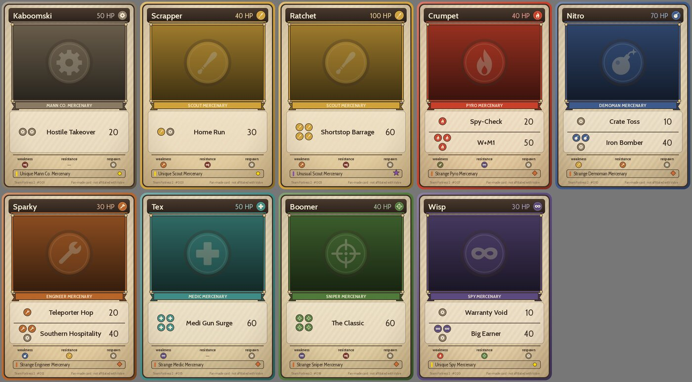
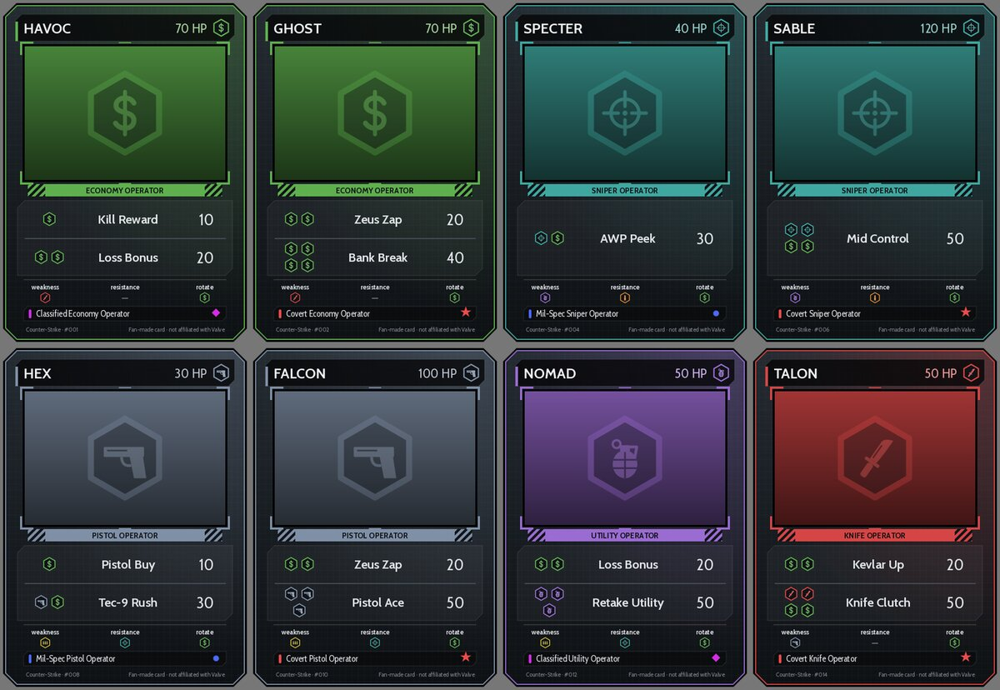

# TF2 & Counter-Strike Card AI Generator

This is a Python script that **generates random, fan-made trading cards** for
**Team Fortress 2** and **Counter-Strike**. It picks an element (a TF2 class or a CS
weapon category), a character and 1-2 abilities, then (optionally) uses AI to name and
describe the cards, and writes a [Midjourney](https://midjourney.com/home) prompt for the artwork.

A separate command combines the card data with the artwork (or a placeholder) to render the cards.

> Forked from [pixegami/pokemon-card-generator](https://github.com/pixegami/pokemon-card-generator).
> Fan project, not affiliated with Valve.

| Team Fortress 2                                    | Counter-Strike                                   |
| -------------------------------------------------- | ------------------------------------------------ |
|  |  |

_(Previews rendered without artwork: the placeholder shows the element icon.)_

## Games

| Game            | `--game` | Elements                                                                                       | Rarities                        | Retreat cost |
| --------------- | -------- | ---------------------------------------------------------------------------------------------- | ------------------------------- | ------------ |
| Team Fortress 2 | `tf2`    | `mann_co` (neutral), `scout`, `soldier`, `pyro`, `demoman`, `heavy`, `engineer`, `medic`, `sniper`, `spy` | Unique, Strange, Unusual        | respawn      |
| Counter-Strike  | `cs`     | `economy` (neutral), `rifle`, `sniper`, `smg`, `pistol`, `utility`, `knife`                    | Mil-Spec, Classified, Covert    | rotate       |

Each element has its own card template, icon, characters, environments, weaknesses and
resistances (e.g. a Spy is weak to Pyro, a Sniper resists Heavy; an SMG is weak to Rifles).

# Setup

1. Install Python 3.10 (or higher)
2. Install the dependencies with `pip install -r requirements.txt`
3. Set your PYTHONPATH to `src` so that the modules can be imported.

   ```bash
   export PYTHONPATH=$PYTHONPATH:src
   ```

## AI names and descriptions (optional)

Names and descriptions are generated with [OpenRouter](https://openrouter.ai/). Put your key in a `.env` file:

```bash
OPENROUTER_API_KEY="sk-or-..."
# Optional:
OPENROUTER_MODEL="openrouter/free"
```

Without a key (or with `--offline`), cards get built-in nicknames/callsigns and a generated description.

**Request budget:** the free tier is limited (~50 requests/day), so the cards are named in
**batches: 1 request per 10 cards** (`--batch-size`). A default run (1 series per element,
~15-20 cards) uses about 2 requests. Ability names come from `data/<game>/ability_names.json`
and never cost a request.

# Usage

Generated files go to `output/<collection>/` (`output/tf2-mercenaries` or `output/cs-operators`).
**WARNING!** Each run overwrites the existing files of that collection.

```bash
python src/generate.py                      # TF2, 1 series (1-3 cards) per class
python src/generate.py -g cs                # Counter-Strike
python src/generate.py -g tf2 -n 3          # 3 series per class
python src/generate.py -g tf2 -e medic      # Only Medic cards
python src/generate.py -g cs -e knife -s "pirate captain"   # Custom character
python src/generate.py -g cs --offline --seed 42            # No AI, reproducible
```

You will see a summary of each card:

```
Kaboomski (Mann Co.)
HP: 50
Rarity: ★  (Unique)
Abilities:
  Hostile Takeover (Mann Co.)
  Cost: ● ●
  Power: 20
```

Each card JSON looks like this:

```json
{
  "game": "tf2",
  "index": 7,
  "name": "Crumpet",
  "description": "...",
  "element": "Pyro",
  "rarity": "Strange",
  "rarity_index": 1,
  "hp": 40,
  "abilities": [
    { "name": "W+M1", "element": "Pyro", "cost": 3, "is_mixed_element": true, "power": 40 }
  ],
  "image_prompt": "Crumpet::0 a seasoned Pyro-class cheerful fire-starter mercenary from Team Fortress 2::1.8, holding a festive flare gun, in a misty alpine sawmill, ...",
  "image_file": "007_crumpet.png"
}
```

## Generate the artwork

By default, `generate.py` also **generates the artwork of each card** from its `image_prompt`
with [Pollinations](https://pollinations.ai) (free, no API key, does not use your OpenRouter
quota). Images are saved to `output/<collection>/images/<image_file>`.

```bash
python src/generate.py -g tf2 --images none         # skip image generation
python src/generate_images.py -g tf2                # generate missing images (e.g. after an error)
python src/generate_images.py -g cs --force         # regenerate every image (new variations)
python src/generate_images.py -g tf2 -p openrouter  # OpenRouter image model (paid, needs credits)
```

With a Pollinations API key, images use the `gen.pollinations.ai` API billed in pollen, with
the model of your choice and no watermark. Without a key, the free anonymous API is used (fixed
low-quality model, watermark cropped off automatically).

```bash
# In your .env file
POLLINATIONS_TOKEN="sk_..."
POLLINATIONS_MODEL="flux"   # optional, see the table below
```

| `POLLINATIONS_MODEL`   | Model                   | Cost / image | Notes                          |
| ---------------------- | ----------------------- | ------------ | ------------------------------ |
| `flux` (default)       | FLUX.1 Schnell          | 0.002 pollen | Best quality for the price     |
| `dreamshaper`          | DreamShaper 8 LCM       | 0.0001 pollen | Cheapest, lower quality       |
| `zimage`               | Z-Image Turbo           | 0.004 pollen | Crisp, upscaled output         |
| `klein`                | FLUX.2 Klein 4B         | 0.005 pollen | Newer FLUX                     |

A run of ~20 cards with `flux` costs about 0.04 pollen. `OPENROUTER_IMAGE_MODEL`
(default `google/gemini-2.5-flash-image`) is used with `-p openrouter` (paid OpenRouter credits).

You can still use Midjourney: paste the `image_prompt` (also in `output/<collection>/_image_prompts.txt`),
save the image in `output/<collection>/images/` with the card's `image_file` name
(e.g. `007_crumpet.png`). Any image ratio works: it is scaled and cropped to the 3:2 window.

## Render the cards

```bash
python src/render_cards.py            # output/tf2-mercenaries
python src/render_cards.py -g cs      # output/cs-operators
python src/render_cards.py --collection path/to/collection
```

Renders go to `output/<collection>/renders/`. Cards without artwork get a placeholder.

# Resources (SVG)

Card templates and element icons are **generated as SVG** by `src/build_resources.py`
and rasterized to the PNGs used by the renderer:

```
resources/<game>/svg/cards/<element>_card.svg        # sources
resources/<game>/svg/elements/<element>_element.svg
resources/<game>/cards/<element>_card.png            # used by render_cards.py
resources/<game>/elements/<element>_element.png
```

To tweak a design (colors, shapes, layout), edit `src/build_resources.py`, the element
colors in `src/games/tf2.py` / `src/games/cs.py`, or the shared geometry in
`src/card_layout.py`, then rebuild (needs `rsvg-convert` from librsvg, or `pip install cairosvg`):

```bash
python src/build_resources.py          # all games
python src/build_resources.py -g cs    # one game
```

# Adding a game

1. Create `src/games/<game>.py` with a `Game(...)` definition (elements, rarities, characters,
   environments, prompts, weaknesses, theme) and register it in `src/games/registry.py`.
2. Add `data/<game>/ability_names.json` (keys: `<element>_<cost>`).
3. Add a card template + icon builder and glyphs in `src/build_resources.py`, then build.

### Acknowledgements

Original project by [pixegami](https://github.com/pixegami/pokemon-card-generator).
Fonts: Cabin and Noto Sans Symbols 2 (SIL Open Font License).
Team Fortress 2 and Counter-Strike are trademarks of Valve Corporation; this is an unofficial fan project.
